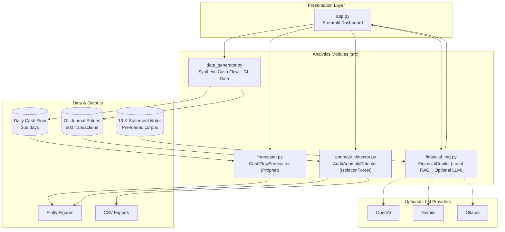

# Enterprise Finance AI Suite

> **Demo notice:** This is not the final product, just a demo made by Shubh Nahar.

An enterprise-grade analytics platform that combines **cash-flow forecasting**, **general-ledger anomaly detection**, and a **10-K variance copilot** in a single Streamlit dashboard. Built for finance teams, audit workflows, and FP&A scenarios where leaders need fast, explainable insights without standing up a full data warehouse first.

---

## Business Value Proposition

| Capability | Business Problem Solved | Outcome |
|---|---|---|
| **Cash Flow Forecaster** | Treasury and FP&A teams struggle to scenario-plan liquidity under uncertainty | 30–90 day Prophet forecasts with 95% confidence bands and adjustable revenue/expense scenarios |
| **GL Anomaly Detector** | Manual audit sampling misses suspicious journal entries at scale | Isolation Forest flags high-risk postings (midnight posts, round amounts, outliers) for auditor review |
| **Financial Variance Copilot** | Analysts spend hours tracing MD&A variances across lengthy 10-K filings | Local RAG over financial statement notes answers variance questions with cited disclosures |
| **Unified Dashboard** | Forecasting, audit, and narrative analysis live in disconnected tools | One executive-ready workspace with KPI cards, interactive charts, and exportable audit tables |

**Who benefits:** CFO offices, controllers, internal audit, FP&A analysts, and finance AI product teams prototyping intelligent automation.

**Why it matters:** The suite demonstrates how modern finance operations can blend **time-series ML**, **unsupervised fraud/anomaly detection**, and **retrieval-augmented generation** into a cohesive decision-support workflow — without mandatory paid API keys for a working demo.

---

## Architecture



### Design Principles

- **Modular `src/` architecture** — business logic stays out of `app.py`
- **Zero-API-key default** — local embeddings + template synthesis for the copilot; Prophet and Isolation Forest run fully on-device
- **Typed, documented Python** — every public function includes annotations and docstrings
- **Executive-ready UX** — KPI header, tabbed workflow, downloadable audit artifacts

---

## Project Structure

```
AI finance Suite/
├── app.py                      # Streamlit dashboard
├── requirements.txt
├── .cursorrules
├── src/
│   ├── data_generator.py       # Synthetic cash flow + GL data
│   ├── forecaster.py           # Prophet forecasting
│   ├── anomaly_detector.py     # Isolation Forest audit scan
│   └── financial_rag.py        # 10-K variance copilot
└── tests/
    ├── conftest.py
    ├── test_data_generator.py
    ├── test_forecaster.py
    └── test_anomaly_detector.py
```

---

## Setup

### Prerequisites

- Python 3.10+
- pip

### Installation

```bash
# Clone or navigate to the project directory
cd "AI finance Suite"

# Create and activate a virtual environment (recommended)
python -m venv .venv
.venv\Scripts\activate        # Windows
# source .venv/bin/activate   # macOS/Linux

# Install dependencies
pip install -r requirements.txt
```

### Run the Dashboard

```bash
streamlit run app.py
```

Open the URL shown in the terminal (typically `http://localhost:8501`).

### Optional: Enable External LLMs

Configure keys in the sidebar — no code changes required:

| Provider | Sidebar Input | Notes |
|---|---|---|
| OpenAI | `OpenAI API Key` | Uses `gpt-4o-mini` via LangChain |
| Gemini | `Gemini API Key` | Uses `gemini-1.5-flash` |
| Ollama | `Ollama Model` | Local open-source models (e.g. `llama3.2`) |

If no key is supplied, the copilot runs in **local mode** using hybrid TF-IDF + sentence-transformer retrieval.

### Run Tests

```bash
pytest tests/ -v
```

Prophet model-fit tests may take 30–60 seconds on first run while Stan compiles.

---

## Dashboard Walkthrough

1. **Header KPIs** — Total inflow, anomalies detected, copilot status
2. **Cash Flow Forecaster** — Adjust horizon, volatility scenario, and revenue/expense assumptions; view Prophet charts with 95% CI
3. **GL Anomaly Detector** — Tune sensitivity, inspect scatter plot, review flagged transactions, download CSV
4. **Financial Variance Copilot** — Browse 10-K notes, ask variance questions, review breakdown summary

---

## Interview Talking Points

Use these when presenting the project in a finance AI, FP&A, or data science interview:

1. **End-to-end finance AI story**
   > "I built a modular suite that mirrors how finance teams actually work: forecast liquidity, audit the GL, and explain variances — three workflows that are usually siloed."

2. **Why Prophet for cash flow**
   > "Daily cash flow has trend and seasonality. Prophet handles both, exposes uncertainty intervals for treasury planning, and supports scenario overlays without retraining."

3. **Why Isolation Forest for audit**
   > "We rarely have labeled fraud in GL data. Isolation Forest is unsupervised, scales well, and surfaces multidimensional outliers — midnight posting times combined with abnormal amounts."

4. **Responsible RAG design**
   > "The copilot defaults to local retrieval and excerpt synthesis so the demo runs without API keys. When a key is provided, answers are grounded in retrieved 10-K note chunks with source citations."

5. **Production-minded architecture**
   > "Logic lives in `src/`, the UI is thin, outputs are typed DataFrames and Plotly figures, and pytest covers data generation, model fitting, and anomaly scoring."

6. **Business metrics framing**
   > "Anomaly detection reduces manual sampling risk. Forecast confidence bands support liquidity conversations. The copilot compresses MD&A research from hours to minutes."

7. **Extension roadmap**
   > "Next steps: connect to ERP exports (NetSuite/SAP), add SHAP explainability for flagged GL rows, persist ChromaDB indexes per filing year, and wire Slack/email alerts for high-risk postings."

---

## Tech Stack

| Layer | Technology |
|---|---|
| UI | Streamlit |
| Forecasting | Prophet, Plotly |
| Anomaly Detection | scikit-learn IsolationForest |
| RAG | TF-IDF, sentence-transformers, LangChain (optional) |
| Data | pandas, NumPy |
| Testing | pytest |

---

## License

This is not the final product, just a demo made by **Shubh Nahar**. The project is provided as a portfolio / demonstration codebase. Adapt and extend for internal or commercial use as needed.
